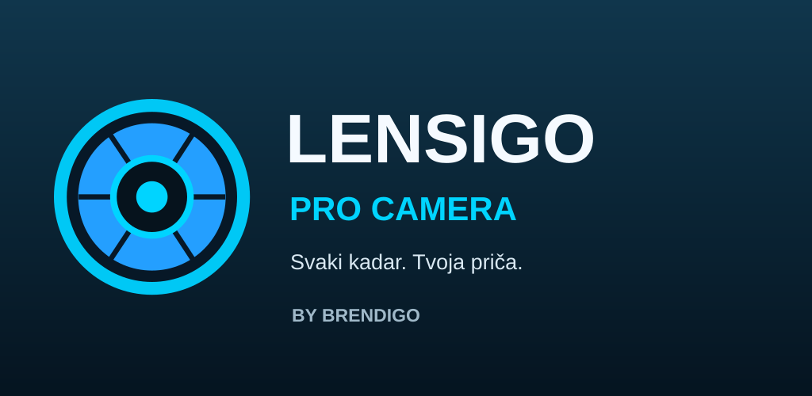
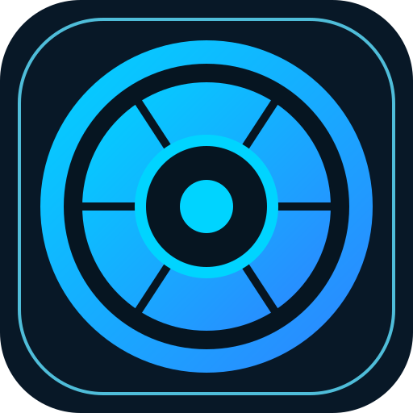

<p align="center"></p>
<h1 align="center">LENSIGO · PRO CAMERA</h1>
<p align="center"><strong>Svaki kadar. Tvoja priča.</strong><br>Every frame. Your story.<br><a href="https://brendigo.com">BY BRENDIGO</a></p>

<p align="center"></p>

## 📷 Profesionalniji kadar — čak i na skromnijem telefonu

LENSIGO je Brendigo Android kamera s jednostavnim sučeljem, lokalnim efektima i postavkama optimiziranima za slabije uređaje. Nova verzija donosi vođenu panoramu i Dual snimanje s provjerom stvarne podrške hardvera. Bez računa, oglasa, telemetrije ili internetske dozvole.

### ✨ Stvarne mogućnosti u verziji 0.5.0

| 📸 Foto | 🎞️ Video | 🎨 Filteri | 💡 Poboljšanja |
|---|---|---|---|
| Fokus dodirom, omjer 4:3/16:9, zum, bljeskalica | Snimanje SD/HD prema dostupnosti uređaja; mikrofon samo uz dozvolu | 12 lokalnih efekata s regulacijom intenziteta | EV kompenzacija, posvjetljivanje noćnih snimaka, blago zaglađivanje šuma, izoštravanje |
| 📁 Galerija | 🪄 Uređivanje | 📱 Kompatibilnost | 🔐 Privatnost |
| Snimke kreirane aplikacijom | Svjetlina, kontrast, zasićenost, filtri i spremanje nove kopije | Android 7.0+, način ograničene memorije | MediaStore, lokalna obrada, bez cloud servisa |

**Pro 0.5.0:** Ručni ISO, brzina zatvarača, WB i MF putem Camera2 podržani su samo kad hardver izloži odgovarajuće karakteristike; u suprotnom kontrole su onemogućene, uz EV kompenzaciju kada je dostupna. **Noć 0.5.0:** proizvođački Night dodatak kada je dostupan, inače lokalno posvjetljivanje. **Portret 0.5.0:** proizvođački Bokeh kada je dostupan, inače umjetničko zamućenje izvan središta kadra koje ne prepoznaje obris osobe.

**Panorama 0.5.0:** 2–5 kadrova s vođenim pomicanjem udesno, lokalno spajanje s 28% preklapanja i spremanje JPEG-a. Jednostavno je ručno poravnanje, bez računalnog prepoznavanja značajki; treba mirno pomicati uređaj. Rezolucija i broj kadrova ograničeni su radi rada na slabijim telefonima.

**Dual 0.5.0:** na telefonima s podrškom CameraX concurrent camera moguć je istodobni pregled prednje kamere u malom okviru iznad stražnje; dvije se fotografije snime redom i lokalno spoje u jednu. Na ostalim telefonima aplikacija jasno vodi kroz dva uzastopna kadra. Nema lažnog prikaza druge kamere. Dual video nije implementiran.

**Pokretanje:** brendirani Splash → dobrodošlica → dozvole (samo prvo pokretanje) → početni zaslon; kasnije se kamera otvara odmah.

### 📁 Galerija / Viewer / Editor 0.5.0

Galerija s četiri aktivna filtra (**Sve, Fotografije, Videozapisi, Favoriti**) i 3-stupačnim prikazom snimaka. Preglednik s dijeljenjem, dupliciranjem u MediaStore, fav oznakom i potvrdom brisanja putem Androidovog sustava dozvola. Uređivač podržava **svjetlinu, kontrast, 12 filtara, intenzitet, središnje izrezivanje na 1:1 / 4:3 / 3:2 / 9:16 i rotaciju od 90°**. Spremanje uvijek stvara novu kopiju — original ostaje neizmijenjen. Način obrade s manjom potrošnjom RAM-a ostaje dostupan.

### ⚙️ Kamera i postavke 0.5.0

Mreža trećina preko live previewa, samookidač 3/5/10 s i opcionalni zvuk okidača. JPEG kvaliteta (70–100%), SD/HD snimanje, pojačavanje oštrine i lokalno ublažavanje šuma. Implementirane postavke su stvarne; RAW/DNG, HEIF, EXIF lokacija, 4K/60 i potpuna HR/EN lokalizacija **još nisu podržani** i ne označavaju se kao funkcionalne.

**12 efekata:** Original · Vivid · Film · Mono · Warm · Cool · Vintage · Fade · Dramatic · Sepia · Noir · Sunset.

> Nema čarobnog povećanja stvarne rezolucije: filtri poboljšavaju izgled postojećih fotografija, ali ne mogu stvoriti detalje koje senzor nije snimio. Za Android 12+ predviđen je grafički pregled filtera na kameri; na starijim verzijama učinak se vidi na spremljenoj snimci i u editoru.

## 🎨 Originalni Brendigo identitet

<p align="center"></p>

**Graphite** `#081827` · **Midnight** `#10364C` · **Cyan** `#00D4FF` · **Blue** `#2E83FF` · **White** `#F5FAFF`.

Svi zasloni koriste tamnu navigaciju i lokalni prikaz kamere. Galerija i uređivač u verziji 0.5.0 bliži su referencama, ali screenshot testovi tek trebaju potvrditi raspored i dimenzije. Za 1:1 provjeru svake referentne slike: [detaljna tablica implementacije i statusa](docs/SCREEN-MATCHING.md).

Originalni korisnički referentni paket sadrži 19 mobilnih i 19 tabletnih konceptnih PNG-ova. Koncepti **nisu** predstavljeni kao stvarni screenshotovi aplikacije; stvarni se screenshotovi dodaju nakon testova.

## ⚙️ Tehnička arhitektura

- Kotlin + Jetpack Compose + AndroidX CameraX; MediaStore i Camera2 kompatibilne kontrole.
- Uređivanje u pozadini, bez uploadanja slika; JPEG obrada ograničena na 2048–3072 px zbog memorije.
- SD video postavljen kao prednost na slabijim uređajima; HD može biti nedostupan.
- Razdvojena jezgra: `FilterEngine.kt`, `MediaLibrary.kt`, `GalleryScreen.kt`, `MainActivity.kt`.
- **Package** `com.brendigo.lensigo`, minSdk 24, targetSdk 36.

```shell
gradle :app:assembleDebug
gradle :app:bundleRelease
```

GitHub Actions nakon **uspješnog** builda objavljuje novi preview Release s `app-debug.apk` (testni APK) i `app-release.aab` (nepotpisani bundle). Za produkcijsku objavu potreban je zaseban sigurni signing workflow i testiranje stvarnih uređaja.

### 🧭 Ostalo u planu

Obrada EXIF metapodataka pri uređivanju, dodatni foto-alati, napredno panoramsko poravnanje, istodobno Dual video snimanje, segmentacija osobe u portretu, RAW/DNG, složenije postavke fokusa i višekadarski Night Mode za uređaje bez proizvođačkog dodatka i potpuni pixel-by-pixel audit 19 zaslona. Neaktivne funkcije nisu predstavljene kao gotove.

### 🔒 Privatnost i licenca

© 2026 Brendigo — https://brendigo.com · MIT LICENSE. CameraX i druge AndroidX komponente imaju vlastite open-source licencne obveze.
